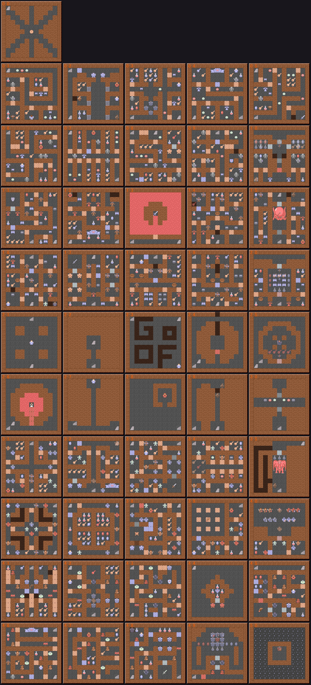

# 01_PC98原版_mtower

> 发行版 asset：`01_PC98原版_mtower.fdi`（attach id 257750）

## 版本真身

**魔法の塔 Ver1.1**（1996，N.W / Oz & Kenichi 前身作品）——PC-9801VX 及 98 兼容机 + MS-DOS 3.1+ 的 PC-98 原版，50 层，开局 HP 1000 / 攻击 100 / 防御 100（神剑神盾）。

| 项 | 值 |
|---|---|
| 主程序 | `game/MTE.EXE`（101303 B，MZ 格式） |
| 文档 | `game/MTE.DOC`（键位与玩法说明） |
| 地图/数据 | `MTOWER1.P58` / `MTOWER2.P58` / `MONSTER.P58` / `ITEM.P58` / `WEAPON.P58` / `GROUND.P58` 等 |
| 磁盘系统 | MS-DOS 5.00A（IO.SYS 为隐藏系统文件），`AUTOEXEC.BAT` 自动运行 `MTE.EXE` |
| 介质 | `01_PC98原版_mtower.fdi`——FDI 映像（4096 B 头 + 1.44 MB 原始盘，80 柱×2 头×18 扇区×512 B） |

## 目录内容

```
01_PC98原版_mtower/
├── 01_PC98原版_mtower.fdi   # 原始发行介质（FDI 软盘映像）
├── game/                    # 从 FDI 提取的全部文件（23 个）
│   ├── MTE.EXE              # 游戏本体
│   ├── COMMAND.COM / IO.SYS(隐藏) / MSDOS.SYS(隐藏)
│   ├── AUTOEXEC.BAT         # 内容：MTE.EXE
│   ├── CONFIG.SYS           # files=20, buffers=30
│   ├── MT.GTX / *.P58       # 地图、怪物、物品、武器等数据
│   ├── INITIAL.DAT          # 游戏存档
│   └── MTE.DOC              # 说明书
├── floor1_01_MTE.png        # 第 1 层实机截图
├── floor1_01_MTE_after_move.png  # 按小键盘 2 后的对比图（923 像素差异，验证可操作）
├── map_50f.png              # 50 层总览（实贴图渲染），已嵌入本 README 的「50 层全图」一节
├── floors/                  # 单层实贴图渲染 floor_01..50.png + floor_00.png + 23/35 标注图
├── tiles/                   # 189 块 imgCrop 实体贴图的切片
├── magic_tower1_map_50f.json    # 逐层地形/物体/暗墙/隐藏层/实体 + 事件动态写入数据
├── magic_tower1_entities.csv    # 全部实体布点（层,y,x,obj,kind,role,名称,HP/ATK/DEF/GOLD）
├── magic_tower1_monsters.csv    # 怪物与道具战力总表
├── magic_tower1_dynamic.csv     # 事件后才出现的隐藏物体 / 动态地形
├── magic_tower1_texts.md          # 塔内全部文案（日/英 + 引用方式 + 出现层），由 README 拆出
├── magic_tower1_texts.csv         # 上述文案的机读版（309 行）
├── magic_tower1_rows.csv        # 大表逐行标记（S 暗墙 / T 隐形块 / E 实体 / B BOSS）
├── magic_tower1_walkroute.md    # 走法路线、危险格、00 层通达方式、隐藏物体说明
├── hidden_floor_band5.png / floor_00.png / MTower_sheet.gif
├── tools/dynscan.py             # 提取“事件动态写入格子”的脚本
├── tools/gen_texts.py           # 生成本文件文案附录与 magic_tower1_texts.csv
└── README.md
```

## 50 层全图



*`map_50f.png`（5 列 × 11 行的层块网格 = 00 层 + 1~50 层，顶行第 1 列即 00 层）。图例：压暗砖墙＝暗墙 / 隐形块 / 事件后可开的墙；
半透明道具＝事件后才出现的隐藏物体，同格多对象时以主图 + 角上贴片叠画；每层左上角两位橙色数字为层号；1F 的 **(6,11)** 为**勇者起点**（不透明贴 `imgCrop[0]`，08 实机确认）。
单层放大图见 `floors/`。*

> 勇者起点：1F `(6,11)`（08 实机读取 `charaX=30,charaY=55` ⇒ 格 (6,11)）。方向帧字段
> `cropIDchara`（init/开局值为 0，故勇者用 `imgCrop[0]` 绘制）。**注意**：01 自带的 `INITIAL.DAT`
> 头部是 `HP=1000 / ATK=100 / DEF=100`（即神剑神盾存档，非 150/10/10 的开局），其位置字段（`+8=1`、`+10=1`、`+26=1280`）我未能解出，
> 所以起点格是按 08 运行时取值的，尚未与 01 交叉验证。

## 怪物战力表

数据源：`magic_tower1_monsters.csv`（战力四维与 `name_cn` 经典译名）。「怪物译名」为经典中文版叫法，「怪物原名」为游戏内日文原名，
依据[百度百科「50层魔塔」词条](https://baike.baidu.com/item/50%E5%B1%82%E9%AD%94%E5%A1%94/4446423)的“敌人资料”表，
按 HP/ATK/DEF 与出现楼层逐条比对得到（金币列个别行该表与原数据有小差异，故只用于对名字，不改数值）。
表内顺序即爬塔顺序（按各怪首次出现层排序），**同名怪只留一行**：大乌贼在数据里被拆成中央 + 八块躯体，
已合并为一行（GOLD 取中央的 100，躯体格为 50）；而绿色/红色/蓝色史莱姆、三型骷髅、三名卫兵、两名巫师的中译本就互不相同，仍各占一行。

| 怪物译名 | 怪物原名 | HP | ATK | DEF | GOLD |
|---|---|---:|---:|---:|---:|
| 绿色史莱姆 | Ｇスライム | 35 | 18 | 1 | 1 |
| 小蝙蝠 | バット | 35 | 38 | 3 | 3 |
| 红色史莱姆 | Ｒスライム | 45 | 20 | 2 | 2 |
| 骷髅人 | スケルトンＣ | 50 | 42 | 6 | 6 |
| 骷髅士兵 | スケルトンＢ | 55 | 52 | 12 | 8 |
| 初级法师 | 僧侶 | 60 | 32 | 8 | 5 |
| 中级卫兵 | 門番Ｂ | 100 | 180 | 110 | 100 |
| 初级卫兵 | 門番Ｃ | 50 | 48 | 22 | 12 |
| 骷髅队长 | スケルトンＡ | 100 | 65 | 15 | 30 |
| 大蝙蝠 | 大バット | 60 | 100 | 8 | 12 |
| 高级法师 | 上級僧侶 | 100 | 95 | 30 | 22 |
| 大史莱姆 | Ｂスライム | 130 | 60 | 3 | 8 |
| 兽人 | ゾンビ | 260 | 85 | 5 | 18 |
| 石头人 | ロック | 20 | 100 | 68 | 28 |
| 兽人武士 | ゾンビナイト | 320 | 120 | 15 | 30 |
| 大乌贼 | 大ダコ | 1200 | 180 | 20 | 100 |
| 幽灵 | スライムマン | 320 | 140 | 20 | 30 |
| 大法师 | 大魔導師 | 4500 | 560 | 310 | 1000 |
| 双手剑士 | 剣士 | 100 | 680 | 50 | 55 |
| 骑士 | 騎士 | 160 | 230 | 105 | 65 |
| 战士 | 兵士 | 210 | 200 | 65 | 45 |
| 鬼战士 | 死霊兵士 | 220 | 180 | 30 | 35 |
| 魔龙 | ドラゴン | 1500 | 600 | 250 | 800 |
| 骑士队长 | 金騎士 | 120 | 150 | 50 | 100 |
| 吸血蝙蝠 | 吸血コウモリ | 200 | 390 | 90 | 50 |
| 高级巫师 | 魔術師Ａ | 200 | 380 | 130 | 90 |
| 初级巫师 | 魔術師Ｂ | 220 | 370 | 110 | 80 |
| 魔法警卫 | 魔導師 | 230 | 450 | 100 | 100 |
| 史莱姆王 | Ｋスライム | 360 | 310 | 20 | 40 |
| 黑暗骑士 | 黒騎士 | 180 | 430 | 210 | 120 |
| 高级卫兵 | 門番Ａ | 180 | 460 | 360 | 200 |
| 吸血鬼 | バンパイア | 444 | 199 | 66 | 144 |
| 魔王（假魔王） | 魔導師ゼノ | 8000 | 5000 | 1000 | 500 |

> 注：这一行同时是 **49F 与 50F 的 BOSS**（引擎运行时放置，见下方「提醒」）；表内数值为封印前。

### 战斗结算规则（读自 `MTower.class` 的 `attackMonster` / `monsStatus`，非推测）

- 我方单次伤害 = `ATK × attackDouble − 怪DEF`；当 `ATK × attackDouble ≤ 怪DEF` 时无法造成伤害。
- `attackDouble` 默认为 1，`monsStatus` 里按怪物的内部编号判定两处翻倍：
  - 持有 **十字架** 且对手为 **兽人 / 兽人武士 / 吸血鬼** → 翻倍；
  - 持有 **ドラゴンスレーヤー（屠龙匕）** 且对手为 **魔龙** → 翻倍。
- 我方损失 = `(怪ATK − 我DEF) × (出手回合数 − 1)`，即打死对手的那最后一击不掉血。
- 封印会改数值：`eventMT` 在完成“骰子五点”封印后写入 `objectAttribute[57][10]=800`、`[11]=500`、`[12]=100`，
  把魔王（obj 57）的 HP/ATK/DEF 从 8000/5000/1000 改成 1/10 —— 表里那行是**封印前**的数值。
- 上述标记与主角四维都不在普通变量里，而是写在 `mapObject` 数组的 stage_flags 块格子上（下表为数组下标 `[row][col]`，与怪物无关）：
  十字架持有 `mapObject[74][119] == 1`、屠龙剑持有 `mapObject[70][120] == 1`；
  主角 HP `mapObject[66][118]`、ATK `mapObject[67][118]`、DEF `mapObject[68][118]`、GOLD `mapObject[69][118]`。

### 三点提醒

- **「大乌贼」不是一只怪，而是一只占 9 格的怪**：15F 的那只由中央与八块躯体共 9 格组成，
  **九格全部是独立战斗单位**（均 1200/180/20，躯体各给 50 GOLD、中央给 100）；
  战力表里已按同名合并成一行（GOLD 取中央的 100）。该词条“汉化缺陷”一节亦提到原版可打 9 次、共得 500 金币，与此吻合。
- **「魔龙」的九宫格与乌贼不同**：35F 的中央可战斗格在 `(x=6, y=7)`，1500/600/250/800；
  环绕它的八格（内部编号 53/54/55/63/64/65/73/75）是躯体装饰格，kind 0 且四维全 0——
  **不可战斗也不能通过**，打魔龙只需打中央那一格。
- **吸血鬼在关卡布点表里没有战斗位**：由 `banpaia` 事件在 20F `(6,6)` 现场生成（详见 `dynamic_objects`）。
- **「魔王」这一行对应 49F 与 50F 两个 BOSS 格，而且都是运行时放上去的**：
  静态层表里 obj 57（魔導師ゼノ）确实没有布点，但 `MTower.class` 里有专门方法 `Zeno(Graphics,int,int)` 与
  `Zeno2(Graphics,int,int)`，方法体末尾就是 `... bipush 57; castore; displayCharacter(...)`；
  `eventMT` 里的调用参数即大表坐标：`Zeno(g,110,55)` → **49F (6,3)**（八格魔法警卫环的正中心）、
  `Zeno2(g,123,57)` → **50F (6,5)**（大厅王座格）。所以 49F、50F 各有一个魔王，共用 obj 57 这行数值。
  完成“骰子五点”封印后 `eventMT` 会把 `objectAttribute[57]` 的 10/11/12 列改写为 **800 / 500 / 100**（原值的 1/10），
  百度百科敌人表里“800×10 / 500×10 / 100×10”那种写法就是这一次改写。
- **本版只有一行魔王数据**：class 内不存在 ATK 1580 / DEF 190 的对象（该常量出现 0 次），
  故百科表「魔王(50层) 8000/1580/190/50」不属于本版（01 与 08 同源）；
  50F 静态铺的是 obj 86（crop 43、type 0、四维全 0）的大厅地砖，中央魔王格由 `Zeno2` 放置。
  地块图上这两格与其余隐藏物体一样叠画（主对象 55% 铺满、次对象 72% 贴在角上），50F 那格同时画出小偷(88)与魔王(57)，数据记在每层的 `runtime_boss`。

## 特殊道具

口径：本表 = **除宝石、血瓶、三色钥匙之外**的所有拾取道具（祭坛 obj22、商店 NPC、记分石 obj69 不算道具）。
「出现楼层」合并两路：静态布点与事件写入（同 §暗墙 / `MAP_NOTES.md` §6.1），`00` 表示 00 层。

| 道具译名 | 道具原名 | 出现楼层 | 备注 |
|---|---|---|---|
| 勇气之珠 | 勇者のオーブ | — | 获得方式未定（见备注）；**关卡内无布点，疑由变长目标写入/商店发放，未定位** |
| 智慧之珠 | 知恵のオーブ | 5 | 文本只说获得，未述效果 |
| 飞行之珠 | 飛翔のオーブ | 1 | 文本未述效果 |
| 铁剑 | 鉄の剣 | 5 | ATK +10 |
| 银剑 | 銀の剣 | 17 | ATK +20 |
| 骑士剑 | 騎士の剣 | 33 | ATK +40 |
| 圣剑 | 聖　剣 | 48 | ATK +50 |
| 神圣剑 | 神　剣 | 13 | ATK +100 |
| 铁盾 | 鉄の盾 | 9 | DEF +10 |
| 银盾 | 銀の盾 | 11 | DEF +20 |
| 骑士盾 | 騎士の盾 | 38 | DEF +40 |
| 圣盾 | 聖　盾 | 43 | DEF +50 |
| 神圣盾 | 神　盾 | 44 | DEF +100 |
| 十字架 | 十字架 | — | 对 ゾンビ / ゾンビナイト / バンパイア 伤害×2（`monsStatus` 置 `attackDouble=2`）；**关卡内无布点，疑由变长目标写入/商店发放，未定位** |
| 圣水 | エリクサー | — | 一次性；按攻防换算回血；**关卡内无布点，疑由变长目标写入/商店发放，未定位** |
| 破坏之球 | 破壊の玉 | 37 | 效果未从代码验证 |
| 中心飞行器 | 空間転移の秘宝 | — | 飞到本层的中心对称点，限 3 次；**关卡内无布点，疑由变长目标写入/商店发放，未定位** |
| 向上飞行器 | 昇華の翼 | 39,45 | 上 1 层；静态与事件两路都有 |
| 向下飞行器 | 降臨の翼 | 41 | 下 1 层 |
| 屠龙匕 | ドラゴンスレーヤー | 49 | 对 ドラゴン 伤害×2（同上 attackDouble） |
| 冰冻魔法 | 雪の結晶 | 35 | 把熔岩冻成通路 |
| 魔法钥匙 | 魔法の鍵 | 46 | 开一层全部黄色门；**非**三色钥匙，故仍在表内 |
| 超级镐 | スーパーマトック | — | 47F 商人（obj170）4000 GOLD 出售；破墙范围大于镐；**关卡内无布点，疑由变长目标写入/商店发放，未定位** |
| 幸运金币 | 幸運の金貨 | 00 | 金币翻倍；在 00 层 (6,6) |
| 镐 | マトック | 15 | 破周围墙；15F 打败大乌贼后掉落 |

**待查清的一栏**：勇气之珠、十字架、圣水、中心飞行器、超级镐 这几件在本版 1–50 层与 00 层的格子里都没有落点——
引擎有 `mapObject[变量][变量]=ID` 形式的发放（与 49F 蓝钥匙同一类），静态指令扫描定位不到坐标，
故只能标"未定位"，不当它不存在。

## 商店与祭坛的运作机制

### 通用流程（读自 `MTower.class`，非推测）

1. 撞上物体后 `directCheck` 按 `objectAttribute[mdata][3]` 分派：**7=祭坛、11=记分石、14=商店出售、15=商店收购**；
   同时把 `mdata`/x/y 暂存进 `mdataBuff`/`XpBuff`/`YpBuff`，设 `strNumber=`该物体文案、
   `yesnoNumber=6`（卖）或 `7`（收）、`yesnoFlag=1` 弹确认菜单。
2. 选"是"后进 `yesnoJudge` 成交：**金币不是字段，而是 `mapObject[69][118]`**（stage_flags 块），报价取
   `objectAttribute[mdataBuff][13]`（`ATR_GOLD`）。先比较 `金币 < 报价` → 不足即拒绝；够则 `金币 −= 报价`，
   再按物体号发放（例：`obj 18` 成交后写 `mapObject[75][118]` 标记 —— 即**限购/一次性**）。
3. **价格不随购买次数上涨。**这条成交路径里没有任何次数加成；早先我把
   `(objectAttribute[mdata][19] − 1) × 25 + 购买次数` 当成涨价算式是错的，那是 **音效声道号**的计算。
   因此攻略常说的"新售价 = 旧价 + 20×已购次数"在这份 class 中找不到对应算子，不采信。

### 商店与收购点一览

报价来自 `ATR_GOLD(13)`；**交付数量取自 NPC 文案**，成交分支里我只逐条读到发放标记（未把每种钥匙的 `+n` 都跟到写回语句），故数量列以文案为准。

| 楼层 | 物体 | 类别 | 报价 | 内容（文案摘要） |
|---|---|---|---:|---|
| 6F | obj18 | 出售 | 50 | 紫钥匙 ×1（"大特价"；成交后写一次性标记） |
| 7F | obj41 | 出售 | 50 | 黄钥匙 ×5 套装 |
| 12F | obj156 | 出售 | 800 | 红钥匙 ×1 |
| 15F | obj159 | 出售 | 200 | 紫钥匙 ×1 |
| 28F | obj161 | **收购** | 100/个 | 收钥匙，玩家卖钥匙换金币的唯一去处 |
| 31F | obj162 | 出售 | 1000 | 黄钥匙 ×4 + 紫钥匙 ×1 |
| 38F | obj164 | 出售 | 200 | 黄钥匙 ×3（"先到先得"） |
| 39F | obj166 | 出售 | 2000 | 紫钥匙 ×3 |
| 45F | obj168 | 出售 | 1000 | 生命力 +2000（唯一直接买生命的商店） |
| 47F | obj170 | 出售 | 4000 | 超级镐（对应道具表 `obj112`） |
| — | obj17 | 出售 | 1000 | "钥匙 Unlimited 每把 1000G"：本版 **1–50 层没有落点**，只登记在图鉴块 ⇒ 与攻略描述不一致，待核 |

### 祭坛（4 座：4F / 12F / 32F / 46F，物体 `obj 22`，type=7）

- 弹出 4 项菜单（`yesnoNumber=9`），标题文案 206「この祭壇に」、条目文案 207 起；选项文本为「・生命力を / ・攻撃力を / ・防御力を / ・やっぱりやめる」。
- **代价按本存档累计使用次数递增**，`directCheck` 里的算式是
  `getcoin = ((k + 1)^2 − (k + 1) + 2) × 10`，`k = mapObject[66][119]`（已祭次数）→ 依次 **20 / 40 / 80 / 140 / 220 / 320 …**
- 档位常量（`saidan` 绘制时用的数值）为 **生命 +200、攻击 +10、防御 +10** 三档。
- ⚠︎ 未跟完的一环：从选项回到主角属性写回、以及 `k` 在哪一步自增，我没有逐条追到语句 ⇒ "同一次存档内递增"是按 `k` 的来源推断的，若要做 TAS 定式需实测一次。

### 记分石（type=11，物体 `obj 69`）

- **静态地图里没有它**，只能由事件生成：**10F / 20F / 25F / 40F / 49F**（每 10 层清场后的奖励格）。
- 文案 224 说明评价方式："用本层为止的 生命 / 防御 / 攻击 / 钥匙数 评定实力"；称号串见文案 232–240
  （`『戦士』『勇者』『英雄』『剣帝』『闘神』…）。
- 具体阈值与分数换算我没有读出（`rankUpdate`/`scoreInit` 未跟），只确定它**只读不消耗**：不扣金币、不给道具。

## 运行方式

PC-98 环境（np2kai 模拟器 + 真实 BIOS ROM）：

```bash
np2kai 01_PC98原版_mtower.fdi
```

启动后 MS-DOS 5.00A 自动通过 AUTOEXEC.BAT 运行 MTE.EXE，直接进游戏。

**键位**（据 `MTE.DOC`）：

- 小键盘 **2/4/6/8**（或方向键）：移动
- **Return / Space**：打开菜单
- **小键盘回车**：菜单内确认
- **Pause 键 = PC-98 STOP**：退出游戏回 DOS

环境搭建要点见仓库根目录 README「PC-98 运行环境」一节。

## 备注

- 本版是整个「魔法の塔」系列的 **PC-98 原版源头**（1996），历史地位最重要。
- 06 版（小学生版）即在本版磁盘环境里运行 `MTJR.COM` 补丁生成 `MTJR.EXE` 得到，二者地图数据同源。

## 塔内文案（已拆分为独立文件）

309 条对话 / 提示文案（日英双语 + 引用方式 + 出现层）见 **[magic_tower1_texts.md](magic_tower1_texts.md)**，
机读版为 [magic_tower1_texts.csv](magic_tower1_texts.csv)。拆分原因：该附录约占本文件 3/4 篇幅，
把版本说明、地图数据与战力表挤到很后面，不利于快速阅读。
